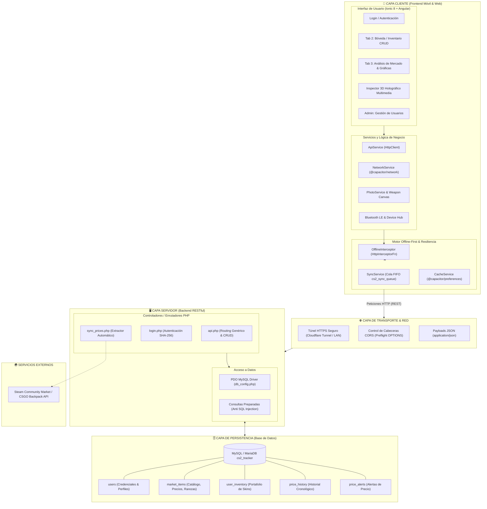
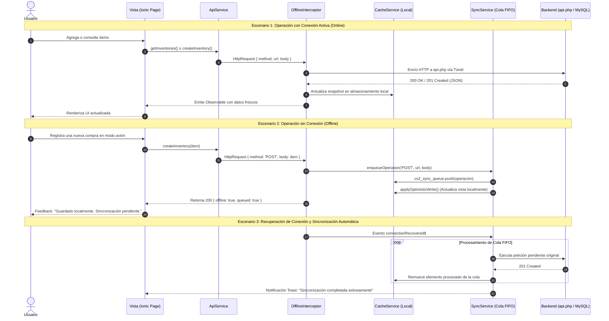

# Diagrama de Arquitectura Cliente-Servidor
**Proyecto:** CS2 Portfolio & Market Trading Assistant  
**Entorno:** Móvil Híbrido (Capacitor / Android) + Web SPA + Backend RESTful + MySQL  

---

## 1. Visión General de la Arquitectura

El sistema implementa una **Arquitectura Cliente-Servidor multicapa desacoplada**, diseñada bajo el paradigma **Offline-First**. Esto permite que la aplicación cliente funcione de manera ininterrumpida tanto en entornos móviles nativos (Android) como en navegadores web, manteniendo persistencia local y sincronizando los datos con el servidor central mediante una API REST protegida por CORS y cifrado HTTPS.

---

## 2. Diagrama de Arquitectura en Bloques (Mermaid)

---

## 3. Diagrama de Flujo de Datos y Ciclo de Vida de Petición

---

## 4. Descripción de las Capas del Sistema

### 4.1 Capa Cliente (Frontend Híbrido y Móvil)
* **Framework:** Ionic 8 + Angular 19/20 bajo arquitectura de componentes Standalone.
* **Runtime Móvil:** Capacitor 8, encargado de empaquetar la aplicación web en un binario nativo Android (`app-debug.apk`), brindando acceso directo a APIs nativas como preferencias del sistema, cámara y estado de red.
* **Componentes Principales:**
  * `LoginPage`: Gestión de sesión del trader y configuración dinámica del endpoint remoto (IP local o dominio de túnel Cloudflare).
  * `Tab2Page`: Bóveda personal de skins, permitiendo agregar compras, calcular valor actual, costo de adquisición y rentabilidad (*Profit* en USD).
  * `Tab3Page`: Dashboard analítico de mercado con gráficas interactivas (`Chart.js` / `ng2-charts`) para visualización de tendencias de precios y volatilidad.
  * `WeaponInspectorComponent`: Inspector 3D con renderizado holográfico, giroscopio/touch tilt, simulador de desgaste (*patina wear filter*) y exportación de fichas PNG mediante Canvas HTML5.
  * `AdminPage`: Gestión de usuarios y control de acceso.

### 4.2 Capa de Resiliencia y Red (Offline-First Engine)
* **`CacheService`:** Implementa almacenamiento persistente local mediante `@capacitor/preferences` (almacenamiento encriptado de Android SharedPreferences en móvil y localStorage en navegador).
* **`SyncService`:** Administra una cola FIFO (`cs2_sync_queue`) que retiene operaciones de mutación (`POST`, `PUT`, `PATCH`, `DELETE`) realizadas sin internet.
* **`OfflineInterceptor`:** Interceptor reactivo que canaliza todas las llamadas HTTP. Si detecta caída de conexión, resuelve consultas `GET` desde la caché y almacena las modificaciones en la cola sin lanzar errores fatales.
* **`NetworkService`:** Emite eventos reactivos (`connectionLost$`, `connectionRecovered$`) monitoreando el estado del hardware de red.

### 4.3 Capa de Transporte
* **Protocolo:** HTTP/1.1 y HTTP/2 sobre TLS/SSL (HTTPS).
* **Acceso Remoto Seguro:** Conectividad mediante Cloudflare Tunnel (`trycloudflare.com`), lo que permite que el dispositivo móvil consuma el backend local sin requerir apertura de puertos en el router ni IP pública fija.
* **Seguridad CORS:** Cabeceras estrictas (`Access-Control-Allow-Origin`, `Access-Control-Allow-Methods`, `Access-Control-Allow-Headers`) y manejo de peticiones de pre-vuelo `OPTIONS`.

### 4.4 Capa de Servidor (Backend RESTful)
* **Lenguaje:** PHP 8.x estructurado con arquitectura basada en controladores ligeros.
* **Enrutamiento:**
  * `login.php`: Endpoint específico para autenticación con verificación de hash criptográfico `SHA-256`.
  * `api.php`: Enrutador RESTful que mapea verbos HTTP directamente sobre las tablas de la base de datos permitidas mediante sentencias preparadas PDO.
  * `sync_prices.php`: Script de sincronización periódica que consulta el mercado de Steam en segundo plano y actualiza el catálogo y la tabla `price_history`.

### 4.5 Capa de Persistencia (Base de Datos)
* **Motor:** MySQL / MariaDB con motor InnoDB (soporte transaccional ACID y claves foráneas en cascada).
* **Tablas del Esquema:**
  1. `users`: Identidad del trader, correo y hash de seguridad.
  2. `market_items`: Catálogo central de skins con precio actual, rareza, exterior y URL de imagen.
  3. `user_inventory`: Relación de ítems adquiridos por cada usuario, precio de compra y cantidad.
  4. `price_history`: Registro cronológico de variaciones de precio y volumen para alimentar las gráficas analíticas.
  5. `price_alerts`: Parámetros de notificaciones para ítems con precios objetivo.
