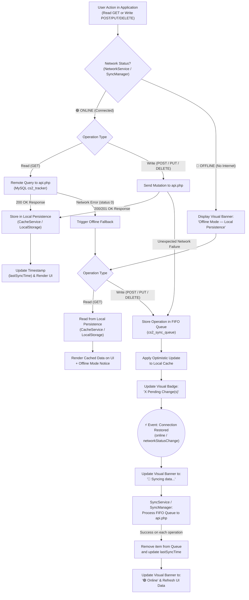
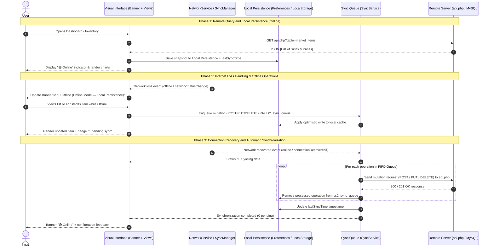

# Synchronization Process Diagram, Local Persistence, and Offline/Online Handling

This document details the architecture for **Local Persistence**, **Remote Querying**, **Internet Loss & Recovery Handling**, **Visual Connection Identification**, and **Automatic Synchronization** implemented in both the Ionic/Angular mobile application (`teste1`) and the Web/Capacitor Dashboard (`www/index.html` and `dashboard.html`).

---

## 1. Synchronization Process Flowchart

---

## 2. Sequence Diagram (Full Offline-First Lifecycle)

---

## 3. Component Architecture Map by Project

| Requirement | Ionic/Angular Project (`c:/test/teste1`) | Web/Capacitor Dashboard (`c:/test/www`) |
| :--- | :--- | :--- |
| **1. Local persistence** | `src/app/services/cache.service.ts` (`@capacitor/preferences`) | `www/sync-manager.js` (`localStorage` + seed dataset) |
| **2. Remote query** | `src/app/services/api.service.ts` (`HttpClient` towards `api.php`) | `www/sync-manager.js` (`loadMarketItems` towards `api.php`) |
| **3. Information synchronization** | `src/app/services/sync.service.ts` (`cs2_sync_queue` + `HttpBackend`) | `www/sync-manager.js` (`saveOrQueueMarketItem` + `syncPendingQueue`) |
| **4. Internet loss handling** | `network.service.ts` (`connectionLost$`) + `offline.interceptor.ts` | `SyncManager.handleConnectionLoss()` + fallback in `loadMarketItems` |
| **5. Connection recovery** | `network.service.ts` (`connectionRecovered$`) triggers `SyncService` | `SyncManager.handleConnectionRecovery()` triggers `syncPendingQueue()` |
| **6. Visual offline/online status** | `app.component.html` / `app.component.scss` (`#connection-status-banner`) | `www/index.html` & `dashboard.html` (`#net-status-banner` + `#verification-panel-modal`) |
| **7. Synchronization diagram** | Standalone deliverable document (`DIAGRAMA_SINCRONIZACION.md`) | Standalone deliverable document (`DIAGRAMA_SINCRONIZACION.md`) |
