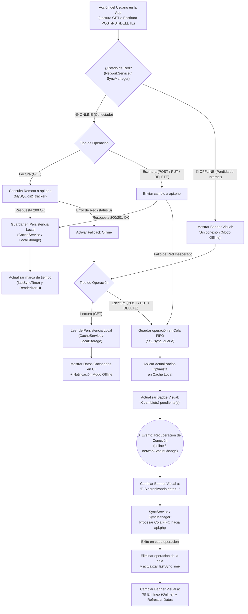
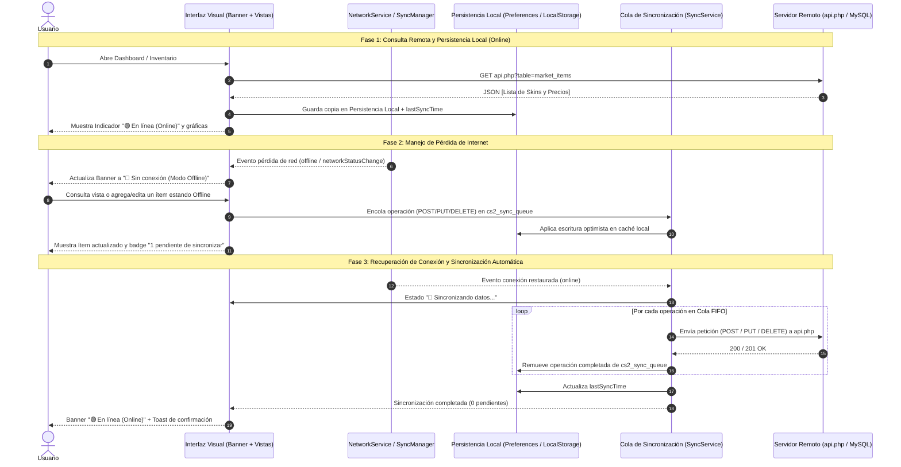

# Diagrama del Proceso de Sincronización, Persistencia Local y Manejo Offline/Online

Este documento detalla la arquitectura de **Persistencia Local**, **Consulta Remota**, **Manejo de Pérdida y Recuperación de Internet**, **Identificación Visual** y **Sincronización Automática** implementada tanto en la aplicación móvil Ionic/Angular (`teste1`) como en el Dashboard Web/Capacitor (`www/index.html` y `dashboard.html`).

---

## 1. Diagrama de Flujo del Proceso de Sincronización

---

## 2. Diagrama de Secuencia (Ciclo Completo Offline → Online)

---

## 3. Mapa de Componentes por Proyecto

| Requerimiento | Proyecto Ionic/Angular (`c:/test/teste1`) | Dashboard Web/Capacitor (`c:/test/www`) |
| :--- | :--- | :--- |
| **1. Persistencia local** | `src/app/services/cache.service.ts` (`@capacitor/preferences`) | `www/sync-manager.js` (`localStorage` + datos semilla) |
| **2. Consulta remota** | `src/app/services/api.service.ts` (`HttpClient` hacia `api.php`) | `www/sync-manager.js` (`loadMarketItems` hacia `api.php`) |
| **3. Sincronización de información** | `src/app/services/sync.service.ts` (`cs2_sync_queue` + `HttpBackend`) | `www/sync-manager.js` (`saveOrQueueMarketItem` + `syncPendingQueue`) |
| **4. Manejo de pérdida de Internet** | `network.service.ts` (`connectionLost$`) + `offline.interceptor.ts` | `SyncManager.handleConnectionLoss()` + fallback en `loadMarketItems` |
| **5. Recuperación de conexión** | `network.service.ts` (`connectionRecovered$`) dispara `SyncService` | `SyncManager.handleConnectionRecovery()` dispara `syncPendingQueue()` |
| **6. Identificación visual offline/online** | `app.component.html` / `app.component.scss` (`#connection-status-banner`) | `www/index.html` y `dashboard.html` (`#net-status-banner` + panel modal `#verification-panel-modal`) |
| **7. Diagrama de sincronización** | Entregable externo independiente (`DIAGRAMA_SINCRONIZACION.md`) | Entregable externo independiente (`DIAGRAMA_SINCRONIZACION.md`) |

